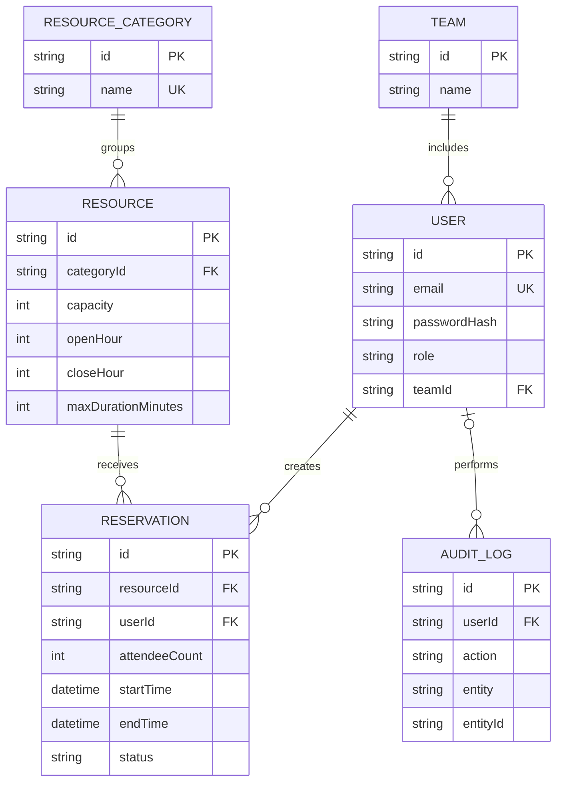

# Resource Reservation

A full-stack resource reservation system for shared workplace facilities. Members can find resources, check availability, and request bookings. Administrators can manage resources and teams, review requests, and inspect the audit log.

## Features

- Member registration and login with hashed passwords and secure sessions.
- Resource catalogue with categories, location, capacity, opening hours, and booking limits.
- Reservation creation, editing, cancellation, and admin approval.
- Daily availability timeline plus a free-slot search by date, time range, category, and number of people.
- Reservation attendee counts are validated against resource capacity in the app and enforced by PostgreSQL.
- PostgreSQL-enforced prevention of overlapping active reservations, including concurrent booking attempts.
- Admin dashboards, team management, and audit history.
- Admins can delete resources with no reservation history and teams; deleting a team unassigns its users without deleting their accounts.
- Sri Lanka time (UTC+05:30) for reservation entry and display.
- Paginated reservation and audit-log lists, validated server actions, and transactional changes with audit records.

## Tech stack

- Next.js App Router and React
- TypeScript
- PostgreSQL
- Prisma ORM 7 with the PostgreSQL driver adapter
- Tailwind CSS

## Local setup

### Requirements

- Node.js 20 or later
- PostgreSQL 14 or later, running locally or at a database URL you can access

### Install and configure

```powershell
npm install
Copy-Item .env.example .env
```

Edit `.env` and set `DATABASE_URL` to your PostgreSQL connection string. Create a unique session secret of at least 32 random bytes:

```powershell
node -e "console.log(require('node:crypto').randomBytes(32).toString('base64'))"
```

Put the generated value in `SESSION_SECRET`. Keep `.env` private and do not commit it.

### Migrate, generate the client, and seed demo data

```powershell
npx prisma migrate dev
npx prisma generate
npx prisma db seed
```

The seed creates sample resources and two local demo accounts:

| Role | Email | Password |
| --- | --- | --- |
| Admin | `admin@example.com` | `Password123!` |
| Member | `member@example.com` | `Password123!` |

These credentials are for local development only. Do not use them in a deployed environment.

### Start the app

```powershell
npm run dev
```

Open [http://localhost:3000](http://localhost:3000).

## Requirements coverage

| Assessment requirement | Implementation |
| --- | --- |
| Several shared facilities and resources | Admin-managed resources and categories; resources include location, capacity, opening hours, and active/inactive status. |
| Different individuals and teams | Member and admin roles; users can belong to a team, and admins can create teams. |
| Prevent overlapping reservations | A PostgreSQL exclusion constraint rejects intersecting pending or approved reservations for the same resource, even when requests race. |
| Resolve uncertainty about availability | `/availability` shows a daily timeline and searches free resources by date, start/end time, category, and attendee count. Pending requests are shown as busy so a second request cannot claim their slot. |
| Understand resource usage | Dashboard reports today's approved-booking utilization and the five most-booked resources over the last 30 days. |
| Stay reliable as activity grows | Server-side Zod validation, indexed reservation lookups, paginated reservation/audit lists, database-enforced booking constraints, and atomic write-plus-audit transactions. The dashboard calculates its top five in PostgreSQL rather than loading every matching booking into the app. |
| Replace informal booking records | Reservation status workflow and admin audit log record the actor, action, target, timestamp, and available before/after details. |

## Design decisions

- **Enforce booking conflicts in PostgreSQL.** An application-only “check then insert” can allow two simultaneous requests to pass the check. The exclusion constraint is the final authority; server-side checks provide earlier, readable feedback. Pending reservations count as busy to avoid offering a slot while it awaits approval. Cancelled and rejected reservations release it.
- **Use half-open time ranges and one reservation per resource at a time.** `[start, end)` allows one reservation to end exactly when another starts. This preserves the core no-double-booking rule even when a resource has spare attendee capacity. Reservations can cross midnight into the following day when the resource is open through midnight and open at the end time; daily opening hours and maximum duration still apply. Multi-day bookings are not supported.
- **Keep teams separate from roles.** A user's team describes their group, while their role controls permissions. New members choose a team at registration; only admins can manage shared resources and review reservations.
- **Validate party size against resource capacity.** Every reservation stores its attendee count. Server validation gives immediate feedback; a PostgreSQL trigger prevents writes above capacity and prevents admins lowering capacity beneath an upcoming pending or approved booking. The same count is available in reservation lists and calendar details.
- **Use Sri Lanka time for human-entered schedules.** Local date/time form values are converted explicitly to UTC instants for PostgreSQL and formatted back as Asia/Colombo, avoiding dependence on the machine's time zone.
- **Make each audited change atomic.** Reservation/resource/team/category writes and their audit records share a database transaction. An audit-write failure rolls the business change back instead of leaving an untracked change.
- **Bound operational lists and aggregate reports in the database.** Reservation and audit screens use fixed-size pagination. The busiest-resources metric uses a database group-by and returns only five results; the dashboard still loads the resource catalogue and the selected day's reservations to calculate utilization.
- **Prefer meaningful cancellation over destructive deletion.** Reservation status changes preserve history and allow a cancelled slot to be reused without erasing the original request.
- **Preserve reservation history when deleting resources.** Resources with any reservations cannot be deleted; admins can deactivate them instead. Deleting a team only removes its memberships, leaving users, reservations, and audit history intact.

## Database model



The migrations add a PostgreSQL exclusion constraint over the resource and reservation time range, and database triggers to keep attendee counts within capacity. Pending and approved reservations therefore cannot overlap, even if two requests arrive at the same time, or exceed the resource capacity. The interval may span midnight into the next calendar day; the same exclusion constraint protects the full interval.

## Useful commands

```powershell
npm run lint
npm run build
npx prisma validate
npx prisma migrate status
```
